# LaporUNSRI 🏛️

> **Platform Aspirasi dan Pelaporan Fasilitas Kampus Universitas Sriwijaya**  
> *Final Project | Web Programming Class | HMIF UNSRI 2026*

---

## 📌 Latar Belakang & Masalah

Di lingkungan kampus Universitas Sriwijaya (baik Kampus Indralaya maupun Palembang), sarana dan prasarana fisik—seperti pendingin ruangan (AC), proyektor, kelistrikan, fasilitas sanitasi, penerangan jalan, hingga trotoar—merupakan faktor krusial bagi kelancaran kegiatan perkuliahan dan aktivitas akademik.

Namun, mekanisme pelaporan kendala fasilitas yang ada saat ini sering menghadapi beberapa masalah:
1. **Penyampaian Masih Tersebar**: Laporan mahasiswa kerap hanya disampaikan melalui pesan grup tidak resmi atau informasi lisan sehingga tidak memiliki nomor tiket dan rekam jejak penanganan yang jelas.
2. **Ketidakpastian Progres Perbaikan**: Mahasiswa tidak mengetahui apakah kendala yang dilaporkan sudah diperiksa, sedang dikerjakan teknisi, atau belum ditindaklanjuti.
3. **Lokasi Masalah Kurang Akurat**: Petugas lapangan sering kesulitan menemukan titik pasti fasilitas yang rusak karena tidak adanya koordinat peta yang presisi.
4. **Penyelesaian Sepihak**: Laporan berisiko dianggap selesai tanpa adanya verifikasi langsung dari mahasiswa pelapor di lokasi.

---

## 💡 Solusi yang Ditawarkan

**LaporUNSRI** dibangun sebagai aplikasi web pelaporan fasilitas kampus yang menghubungkan mahasiswa pelapor, petugas teknisi lapangan, dan administrator dalam satu alur kerja yang terstruktur dan transparan:

- **Pemetaan Titik Presisi (Interactive Leaflet Map)**: Pelapor dapat menandai titik koordinat GPS fisik kerusakan langsung di atas peta kampus.
- **Siklus Hidup Status Satu Arah (*One-Way State Machine*)**: Penegakan alur status ketat di level basis data (`belum_diproses` ➔ `diproses` ➔ `menunggu_konfirmasi` ➔ `selesai`) sehingga status tidak dapat dimanipulasi atau dimundurkan.
- **Verifikasi Dua Arah (*Citizen Confirmation*)**: Petugas yang menyelesaikan perbaikan wajib mengunggah foto bukti penanganan di lapangan. Laporan baru berpindah ke status `selesai` setelah mahasiswa pelapor asli melakukan verifikasi dan konfirmasi.
- **Pengawasan & Auto-Eskalasi**: Sistem secara otomatis menandai laporan yang belum ditangani lebih dari 7 hari sebagai *"Perlu Eskalasi Segera"* pada dashboard admin.
- **Dukungan Komunitas (Upvote)**: Mahasiswa lain dapat memberikan dukungan pada aduan yang sama agar menjadi prioritas penanganan sarpras.

---

## 🛠️ Tech Stack

### Frontend
- **Framework & Build Tool**: React 19, Vite
- **Styling**: Tailwind CSS v4
- **Routing**: React Router DOM v7
- **Form Management & Validasi**: React Hook Form + Zod (`@hookform/resolvers/zod`)
- **Peta Interaktif**: Leaflet & `@types/leaflet`
- **Visualisasi Data**: Recharts (Donut Ring Chart)
- **Animasi & Interaksi**: Framer Motion, Lenis Smooth Scroll
- **Ikon**: React Icons (`fi`)

### Backend & Database (Supabase)
- **Supabase Auth**: Autentikasi sesi berbasis JWT dan pemulihan state saat refresh.
- **PostgreSQL 15+**: Relasi tabel, *Triggers*, dan *Stored Procedures / RPC Functions*.
- **Row Level Security (RLS)**: Pembatasan akses berbasis peran (`authenticated`, `role = 'mahasiswa' | 'petugas' | 'admin'`).
- **Supabase Storage**: Bucket publik `report-photos` untuk penyimpanan foto bukti kerusakan dan dokumentasi penanganan.

---

## 👥 Role-Based Access Control (RBAC)

Aplikasi memiliki **3 peran pengguna** dengan hak akses dan dashboard yang terisolasi:

1. **Mahasiswa**:
   - Mengisi formulir aduan fasilitas kampus (judul, kategori, deskripsi, lokasi, koordinat GPS peta, foto bukti).
   - Memantau status laporan secara berkala di dashboard mahasiswa.
   - Memberikan dukungan (*upvote*) pada laporan mahasiswa lain di katalog publik.
   - Melakukan konfirmasi penyelesaian dan ulasan penanganan (*citizen verification*).
2. **Petugas Sarpras**:
   - Memantau daftar antrean penugasan fasilitas kampus.
   - Mengambil aduan dan memperbarui status menjadi `diproses`.
   - Mengunggah foto dokumentasi hasil perbaikan di lapangan dan memindahkan status ke `menunggu_konfirmasi`.
3. **Administrator Kampus**:
   - Memantau ringkasan performa dan diagram ring distribusi penanganan seluruh fasilitas kampus.
   - Mengawasi laporan yang melebihi batas waktu (auto-eskalasi ≥ 7 hari).
   - Mengelola kategori fasilitas kampus (tambah, ubah nama, hapus).

---

## 🔄 Alur Pelaporan (User Flow)

```mermaid
flowchart LR
    A["Mahasiswa Masuk Akun"] --> B["Buat Laporan & Titik Peta"]
    B --> C["Status: Belum Diproses"]
    C --> D["Petugas Mengambil Penugasan"]
    D --> E["Status: Diproses (Perbaikan Lapangan)"]
    E --> F["Petugas Upload Bukti Penanganan"]
    F --> G["Status: Menunggu Konfirmasi"]
    G --> H["Mahasiswa Pelapor Verifikasi"]
    H --> I["Status: Selesai (Final & Terkunci)"]
```



1. **Pengajuan Aduan**: Mahasiswa masuk akun, mengisi data kerusakan dengan validasi Zod, menandai titik di Leaflet Map, dan mengunggah foto bukti.
2. **Penugasan**: Petugas memeriksa daftar aduan masuk dan memulai penanganan (`diproses`).
3. **Dokumentasi Lapangan**: Petugas menyelesaikan perbaikan fisik di lokasi, mengambil foto hasil penanganan, lalu mengajukan konfirmasi (`menunggu_konfirmasi`).
4. **Verifikasi Pelapor**: Mahasiswa pelapor meninjau hasil dokumentasi dan mengonfirmasi penyelesaian (`selesai`).

---

## 🗄️ Skema Database & Relasi Tabel

Database terdiri dari **5 tabel relasional** utama di luar tabel bawaan Supabase:

1. **`profiles`**: Menyimpan metadata profil pengguna (`full_name`, `role`, `nim_nip`, `avatar_url`) yang berelasi dengan `auth.users(id)`.
2. **`categories`**: Daftar kategori fasilitas fisik (AC, Listrik, Sanitasi, Gedung, dll).
3. **`reports`**: Tabel utama aduan fasilitas yang berelasi dengan `profiles(id)` dan `categories(id)`.
4. **`report_history`**: Audit trail otomatis yang mencatat riwayat perubahan status laporan, waktu penanganan, dan catatan tindak lanjut petugas.
5. **`report_upvotes`**: Relasi *many-to-many* untuk pencatatan dukungan satu suara per mahasiswa pada setiap aduan.

Seluruh DDL SQL, trigger transisi status satu arah (`trg_enforce_report_status_transition`), dan fungsi RPC tersimpan terpusat di folder [`supabase/migrations/`](./supabase/migrations/) dan [`supabase/full_schema_setup.sql`](./supabase/full_schema_setup.sql).

---

## 🚀 Panduan Menjalankan Project (Local Development)

### 1. Prasyarat Sistem
- **Node.js**: Versi 18+ (disarankan versi LTS)
- **NPM**: Versi 9+
- Project aktif di [Supabase](https://supabase.com/)

### 2. Kloning Repositori
```bash
git clone https://github.com/mhdaditiapratama/LaporUNSRI.git
cd LaporUNSRI
```

### 3. Instalasi Dependensi
```bash
npm install
```

### 4. Konfigurasi Environment Variables (`.env`)
Salin berkas template `.env.example` menjadi `.env`:
```bash
cp .env.example .env
```
Buka berkas `.env` dan masukkan kredensial project Supabase Anda:
```env
VITE_SUPABASE_URL=https://your-project.supabase.co
VITE_SUPABASE_PUBLISHABLE_KEY=your-supabase-publishable-key
```

### 5. Setup Database Supabase
1. Buka dashboard project Supabase di browser.
2. Masuk ke menu **SQL Editor**.
3. Buka berkas [`supabase/full_schema_setup.sql`](./supabase/full_schema_setup.sql) pada repositori ini, salin kodenya, lalu tempel dan jalankan di SQL Editor Supabase.
4. Pastikan storage bucket publik bernama **`report-photos`** sudah aktif untuk penyimpanan foto bukti laporan.

### 6. Menjalankan Aplikasi
```bash
npm run dev
```
Aplikasi akan aktif secara lokal di `http://localhost:5173`.

---

## 📜 Perintah yang Tersedia

| Perintah | Deskripsi |
|---|---|
| `npm run dev` | Menjalankan server pengembangan Vite lokal |
| `npm run build` | Menjalankan type-checking TypeScript dan kompilasi bundle produksi |
| `npm run lint` | Menjalankan pemeriksaan kualitas kode dengan ESLint |
| `npm run preview` | Menjalankan preview lokal dari hasil kompilasi produksi di folder `dist/` |

---

## 📁 Struktur Folder Project

```text
LaporUNSRI/
├── public/                 # Aset publik statis
├── src/
│   ├── assets/             # Gambar ilustrasi, maskot, ikon SVG
│   ├── components/
│   │   ├── admin/          # Komponen khusus admin (status ring card, chart)
│   │   ├── common/         # Komponen reusable (Brand, Modal, Skeleton, dll)
│   │   ├── home/           # Seksi landing page (Hero, About, Flow, FAQ, Footer)
│   │   ├── layout/         # Layout wrapper (Auth, Student, Navbar)
│   │   └── report/         # Komponen laporan (Card, Filter, Leaflet Map)
│   ├── context/            # Global context (AuthContext)
│   ├── hooks/              # Custom hooks reusable (useAuth)
│   ├── lib/                # Inisialisasi library pihak ketiga (supabaseClient)
│   ├── pages/
│   │   ├── admin/          # Halaman Admin Dashboard & Kelola Kategori
│   │   ├── auth/           # Halaman Login & Registrasi
│   │   ├── common/         # Halaman Pengaturan Profil Akun
│   │   ├── officer/        # Halaman Petugas Sarpras Dashboard
│   │   ├── public/         # Landing Page & Halaman 404
│   │   └── student/        # Halaman Mahasiswa (Dashboard, List, Form, Detail)
│   ├── routes/             # Konfigurasi routing & route guards (AppRoutes)
│   ├── schemas/            # Skema validasi Zod (auth.ts, report.ts)
│   ├── services/           # Lapisan data service Supabase (auth, report)
│   ├── types/              # Definisi tipe data TypeScript
│   └── utils/              # Fungsi utilitas pembantu (date, report, text)
├── supabase/
│   ├── migrations/         # Berkas SQL migrasi bertahap
│   └── full_schema_setup.sql # Skrip setup database Supabase sekali jalan
├── REQUIREMENT.md          # Ketentuan & rubrik penilaian final project HMIF
├── AGENTS.md               # Aturan & konvensi pengembangan database
└── package.json
```

---

## 👤 Pengembang

- **Nama**: M. Aditia Putra Pratama
- **Project**: Final Project Pemrograman Web — HMIF UNSRI 2026
